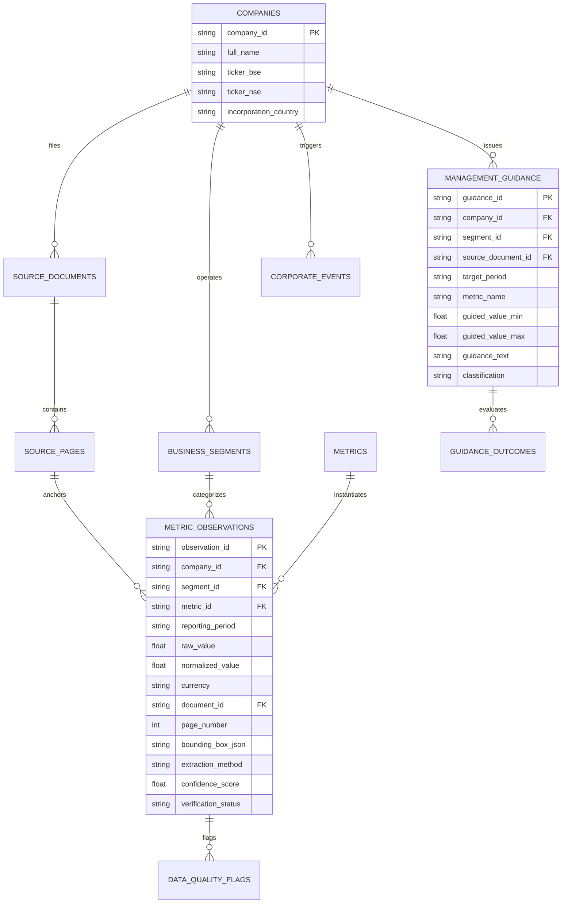

# FOODIQ — Technical Architecture Handbook
**Document Reference:** `FOODIQ-ARCH-TECH-2026-11`  
**System Version:** `v1.0.0-PRODUCTION-MATURITY`  
**Architecture Style:** Modular Financial Micro-Kernel with Normalized Relational Warehouse  
**Backend Framework:** Python 3.12 / FastAPI (Asynchronous ASGI)  
**Database Engine:** SQLite 3 (WAL Mode, Foreign Key Enforcement, Strict Check Constraints)  
**Frontend Stack:** Vanilla ES6 JavaScript, Native Vector `<canvas>`, CSS3 Grid/Flexbox

---

## 1. High-Level System Architecture Diagram

```mermaid
graph TD
    subgraph Primary Sources
        PDF1["Eternal Shareholder Letters (8 PDFs, 285 Pages)"]
        PDF2["Swiggy Letters & DRHP (6 PDFs, 224 Pages)"]
    end

    subgraph Data Ingestion & Governance Layer
        OCR["PDF Bounding-Box OCR Extractor"]
        PROV["SHA-256 Provenance & Checksum Service"]
        DQ["Data Quality & Anomaly Scanner"]
        REG["Disclosure Lifecycle Register & Audit Log"]
    end

    subgraph Relational Data Warehouse [SQLite 3 · data/foodiq.db]
        T_COMP["companies (2)"]
        T_SEGS["business_segments (14)"]
        T_DOCS["source_documents (14)"]
        T_PAGES["source_pages (509)"]
        T_METRICS["metrics (120)"]
        T_OBS["metric_observations (570)"]
        T_RULES["comparability_rules (6)"]
        T_GUIDE["management_guidance (18)"]
        T_SCEN["saved_scenarios (31)"]
        T_REP["generated_reports (62)"]
    end

    subgraph Core Financial Analytics Micro-Kernel
        M_DECOMP["decomposition.py (Waterfall Engine)"]
        M_BRIDGE["margin_bridge.py (Sequential Bridges)"]
        M_UE["unit_economics.py (Cost Stack)"]
        M_GAPS["competitive_gaps.py (Duopoly Attribution)"]
        M_SB["structural_breaks.py (Chow F-Test)"]
        M_CRED["credibility_engine.py (26 Commitments)"]
        M_QUANT["statistical_research.py (10 Studies & FDR)"]
        M_SCEN["scenario_lab.py (AOV Solver & Monte Carlo)"]
        M_REP["report_engine.py (9 Report Archetypes)"]
    end

    subgraph FastAPI REST Service Layer [81 Endpoints]
        API_ANALYTICS["/api/v1/analytics/*"]
        API_COMPETITIVE["/api/v1/competitive/*"]
        API_CREDIBILITY["/api/v1/credibility/*"]
        API_QUANT["/api/v1/quantitative/*"]
        API_SCENARIOS["/api/v1/scenarios/*"]
        API_REPORTS["/api/v1/reports/*"]
        API_DISCLOSURES["/api/v1/disclosures/*"]
        API_EXTENSIONS["/api/v1/extensions/*"]
    end

    subgraph Institutional Research Workstation UI
        UI_OVERVIEW["1. Executive Overview (KPIs & Dual-Axis Chart)"]
        UI_COMPANY["2. Company Analysis (Segment Breakdown)"]
        UI_FIN["3. Financial Performance (Waterfall & Bridges)"]
        UI_COMP["4. Competitive Intelligence (8 Findings)"]
        UI_CRED["5. Management Credibility (Scorecard)"]
        UI_QUANT["6. Quantitative Research (Studies & Workbench)"]
        UI_SCEN["7. Scenario & Sensitivity Lab"]
        UI_LIB["8. Research Library (Saved Models)"]
        UI_SOURCES["9. Data & Sources (PDF Coordinate Lineage)"]
        UI_GOV["10. Comparability Governance (Tier Matrix)"]
    end

    PDF1 --> OCR
    PDF2 --> OCR
    OCR --> PROV --> DQ --> REG
    REG --> T_OBS
    T_OBS --> Core Financial Analytics Micro-Kernel
    Core Financial Analytics Micro-Kernel --> FastAPI REST Service Layer
    FastAPI REST Service Layer --> Institutional Research Workstation UI
```

---

## 2. Database Architecture & ER Diagram

The database (`data/foodiq.db`) is structured into **24 relational tables** with zero synthetic data fabrication.



---

## 3. Backend Module Organization

```
backend/
├── alembic/                      # Database schema migrations
│   └── versions/                 # Initial migration scripts
├── app/
│   ├── main.py                   # FastAPI ASGI entrypoint, CORS, exception handlers
│   ├── config.py                 # Pydantic v2 application settings and path resolvers
│   ├── database.py               # SQLAlchemy async & sync engine bindings, session maker
│   ├── analytics/                # 21 Financial & Econometric Analytics Engines
│   │   ├── decomposition.py      # Waterfall growth decomposition & Executive KPIs
│   │   ├── margin_bridge.py      # Sequential contribution margin bridges
│   │   ├── unit_economics.py     # QC and Food Delivery per-order unit cost stack
│   │   ├── competitive_gaps.py   # Spreads, market shares, take rate gaps
│   │   ├── structural_breaks.py  # Chow test for structural break detection
│   │   ├── credibility_engine.py # 26 management commitment tracker & scorecard
│   │   ├── statistical_research.py # 10 econometric studies, FDR control, detrending
│   │   ├── scenario_lab.py       # AOV break-even solver & Monte Carlo simulator
│   │   ├── report_engine.py      # 9 Institutional report archetypes & verification
│   │   ├── exporter.py           # HTML, PDF, DOCX, CSV export formatters
│   │   └── extension_framework.py# Dynamic registry for companies, metrics, and models
│   ├── api/v1/                   # 17 RESTful Route Controllers
│   │   ├── analytics.py          # /api/v1/analytics/*
│   │   ├── competitive.py        # /api/v1/competitive/*
│   │   ├── credibility.py        # /api/v1/credibility/*
│   │   ├── quantitative.py       # /api/v1/quantitative/*
│   │   ├── scenarios.py          # /api/v1/scenarios/*
│   │   ├── reports.py            # /api/v1/reports/*
│   │   ├── disclosures.py        # /api/v1/disclosures/*
│   │   └── extensions.py         # /api/v1/extensions/*
│   ├── models/                   # SQLAlchemy ORM Data Models (24 tables)
│   ├── schemas/                  # Pydantic Request/Response Validation Schemas
│   └── services/                 # Lineage service & Governance service
└── tests/                        # 145 Pytest Automated Test Specs
```

---

## 4. Frontend Architecture & Design System

- **Zero Build Requirement:** Runs directly in any browser without npm, webpack, or node compilation.
- **Native Vector Canvas:** `drawOverviewTrendCanvas()` computes pixel-exact dual axes (left: ₹ Cr, right: Stores) with interactive mousemove tooltips and structural break annotations.
- **Multi-Viewport Responsive Breakpoints:**
  - `> 1200px`: Desktop full workspace layout.
  - `992px - 1199px`: Laptop compacted grid.
  - `768px - 991px`: Tablet responsive navigation.
  - `< 768px`: Mobile mode activating `#mobile-workspace-select` dropdown and sticky table horizontal scrolling.

---

## 5. Extensibility Framework

FoodIQ provides a dedicated extension framework (`backend/app/analytics/extension_framework.py`) allowing future developers to register:
1. **New Companies:** via `POST /api/v1/extensions/companies` (e.g., onboarding Zepto).
2. **New Metrics:** via `POST /api/v1/extensions/metrics` with custom mathematical formula strings.
3. **New Analytics Modules:** via `POST /api/v1/extensions/modules` allowing external algorithm execution.
4. **Lifecycle Hooks:** `pre_ingest`, `post_ingest`, `pre_report`, and `post_report` event triggers.
