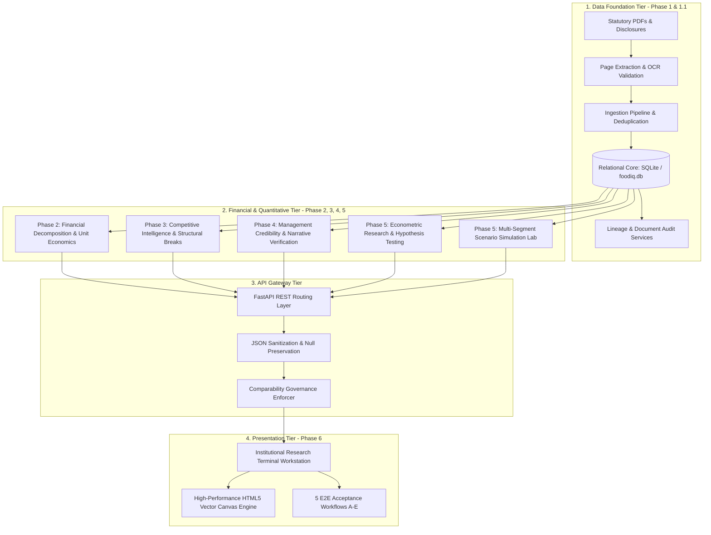

# FoodIQ — Master Architecture Specification

## 1. System Mission & Scope

FoodIQ is an institutional-grade financial intelligence and quantitative research platform analyzing India's two leading food delivery and quick commerce giants:
- **Eternal Limited** (formerly Zomato Limited): Comprising Zomato (Food Delivery), Blinkit (Quick Commerce), Hyperpure (B2B Supplies), District (Live Events & Dining Out), and corporate initiatives.
- **Swiggy Limited**: Comprising Food Delivery, Instamart (Quick Commerce), Out-of-Home (Dining Out), Supply Chain (formerly Lynks), and Platform Innovations.

FoodIQ transforms unstructured corporate disclosures (Quarterly Shareholder Letters, Earnings Releases, Investor Presentations, Audited Financial Statements, and IPO Prospectuses) into a traceable, mathematically defensible, and statistically verified competitive intelligence system.

---

## 2. Multi-Tier System Architecture

FoodIQ is architected in four tightly integrated functional layers:

---

## 3. Core Architectural Modules

### 3.1 Relational Data Foundation (`backend/app/models/core.py`)
- **Companies:** Master identifiers (`ETERNAL`, `SWIGGY`).
- **Source Documents:** Filing types, filing dates, reporting periods, and SHA-256 hashes.
- **Source Pages:** Physical page numbers, OCR extracted text snippets, and confidence scores.
- **Business Segments:** Standardized segments across Food, Quick Commerce, Out-of-Home, and B2B.
- **Metric Definitions:** Canonical definitions, formula dependencies, unit types, and reporting frequencies.
- **Metric Observations:** Temporal observations with primary source document page citations, extraction confidence, and raw-vs-adjusted flags.
- **Comparability Rules:** 4-tier governance classifying pairs into Level 1 (Directly Comparable) through Level 4 (Incomparable).
- **Saved Scenarios:** Relational persistence for customized simulation runs.

### 3.2 Financial & Competitive Engines (`backend/app/analytics/*`)
- `financial_engine.py`: Unit economics decomposition (GOV, AOV, orders, take rates, contribution margins, Adjusted EBITDA).
- `comparability_engine.py`: Strict enforcement preventing invalid math (e.g. subtracting Blinkit 1P revenue from Swiggy 3P marketplace revenue).
- `structural_breaks.py`: Formal accounting reconciliation of Blinkit 1P transition, District acquisition, and Lynks divestment.
- `credibility_engine.py`: 26 management commitments evaluated against empirical facts across 16 categories with strict/broad scoring.
- `statistical_research.py`: 12 econometric studies, Pearson $r$, Spearman $\rho$, $p$-values, Fisher $z$ 95% CIs, first-difference detrending ($r_\Delta$), lag-1 correlations, and Benjamini-Hochberg FDR multiple-testing correction.
- `scenario_lab.py`: Multi-segment simulation with strict parameter pedigree isolation (`EMPIRICAL_ESTIMATE_OLS`, `MANAGEMENT_GUIDANCE`, `ANALYST_ASSUMPTION_NOT_EMPIRICAL_QC`), 2D sensitivity matrices, break-even thresholds, and 1,000-draw Monte Carlo uncertainty distributions.

### 3.3 Institutional Workstation (`frontend/*`)
- Single Page Application served directly by FastAPI at `/`.
- Institutional terminal aesthetics with 10 dedicated analytical workspaces.
- Zero external build tools; native ES6+, CSS3 Grid, and HTML5 Canvas.

---

## 4. Engineering Principles & Guardrails

1. **Zero Hallucination / Zero Imputation:** No artificial filling of missing data. Undisclosed metrics remain strictly `NULL`.
2. **Pedigree Isolation:** Never mix empirical econometric estimates (such as Instamart's 0.9506 bps/₹1 AOV elasticity) with food delivery assumptions or subjective management guidance.
3. **Reproducibility:** 100% of analytical findings, scorecards, and econometric tables are generated programmatically via automated test suites and reproducible scripts.
