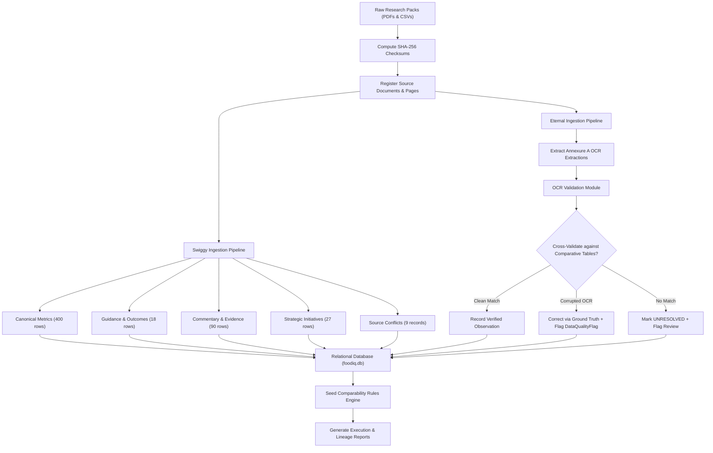

# FoodIQ — Ingestion Architecture & Extraction Pipelines

## 1. Overview
The FoodIQ ingestion pipeline transforms raw shareholder letters (PDFs) and extracted tables into a clean, normalized relational database. The pipeline is designed around three tenets:
1. **Source Immutability:** PDFs in `PDFs/` are strictly read-only and indexed via SHA-256 cryptographic hashes.
2. **Company Independence:** Swiggy and Eternal pipelines execute independently to avoid cross-contamination of company definitions or accounting perimeters.
3. **Dual-Pass OCR Validation:** Scanned table extractions are cross-referenced against subsequent multi-quarter comparative disclosures to resolve OCR errors before persisting verified values.

---

## 2. Pipeline Execution Flow

---

## 3. Dedicated Swiggy Ingestion Pipeline
- **Canonical Metrics:** Ingests 400 long-form metrics spanning Q1FY25 through Q2FY27 across 6 segments (`Food`, `QuickCommerce`, `OutOfHome`, `SupplyChain`, `PlatformInnovations`, `Platform`).
- **Guidance & Outcomes:** 18 forward-looking commitments with exact quotes, milestone deadlines, and status as of Q2FY27.
- **Data Quality & Conflicts:** Automatically logs 20 documented quality issues and 9 source conflicts into `data_quality_flags` and `source_conflicts`.

---

## 4. Dedicated Eternal Ingestion Pipeline & OCR Validation
- **Document Register:** Ingests 8 corporate disclosure filings (April 2025 Overview + 7 quarterly shareholder letters) covering 285 pages.
- **Annexure A Quarterly Disclosures:** Processes 7 OCR files containing quarterly B2C GOV/NOV, segment adjusted revenues, and adjusted EBITDA.
- **Comparative Disclosures Resolution:** Eternal letters publish trailing multi-quarter comparisons (e.g. Q2FY27 publishes Q2FY26–Q2FY27; Q4FY26 publishes Q4FY25–Q4FY26). The `EternalOCRValidator` cross-checks each raw OCR string against clean subsequent digital comparative disclosures.
  - *Example:* Raw OCR `g281` on Q2FY26 Annexure A is recognized as an optical scan error for `8281` (Food Delivery NOV Q2FY25) based on the Q2FY27 comparative table. The pipeline records `raw_source_value = "g281"`, `verified_value = 8281.0`, and creates a `DataQualityFlag`.
- **Structural Break Registration:** Records the Q2 FY26 Blinkit 1P inventory accounting transition as a `CorporateEvent` affecting revenue comparability.
