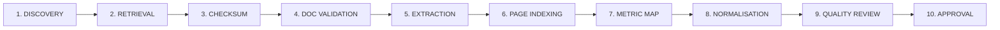

# FoodIQ Phase 8 — Controlled Ingestion Pipeline Architecture

## 1. 10-Stage Controlled Ingestion Pipeline

To protect the integrity of financial research, FoodIQ implements a strictly gated, 10-stage ingestion workflow:

### Stage Details
1. **DISCOVERY:** Identification of new statutory filings via IR monitoring or manual submission.
2. **RETRIEVAL:** Downloading of official PDF filing to secure local staging directory (`data/uploads/`).
3. **CHECKSUM:** Computation of SHA-256 hash. Duplicate hashes trigger immediate rejection to prevent re-ingestion noise.
4. **DOCUMENT VALIDATION:** Verification of PDF file integrity, page count, and metadata readability.
5. **EXTRACTION:** Dual-pass text extraction preserving page boundaries and identifying scanned tables.
6. **PAGE INDEXING:** Recording page text snippets and physical page numbers in `source_pages`.
7. **METRIC MAP:** Canonical metric key resolution matching disclosure terminology to standard definitions.
8. **NORMALISATION:** Unit conversion (e.g. Lakhs to Crores, annualized to quarterly run-rate).
9. **QUALITY REVIEW:** Automated scan for broken identities (GOV vs Orders * AOV) and QoQ jumps.
10. **APPROVAL & INTEGRATION:** Analyst review, cryptographic promotion to production, and research impact re-indexing.

---

## 2. Idempotency & Rollback Guarantees

- **Idempotency:** Re-running the pipeline on an already-ingested filing produces zero duplicate rows due to SHA-256 deduplication and unique database constraints.
- **Analyst Approval Gating:** Newly uploaded filings enter `PENDING_REVIEW` status and cannot alter public research metrics until an analyst explicitly calls `/api/v1/disclosures/{id}/approve`.
- **Atomic Rollback:** If an unapproved disclosure is rejected or found erroneous, `/api/v1/disclosures/{id}/rollback` atomically resets its processing status to `REJECTED`, logging the event to `ingestion_action_log`.
